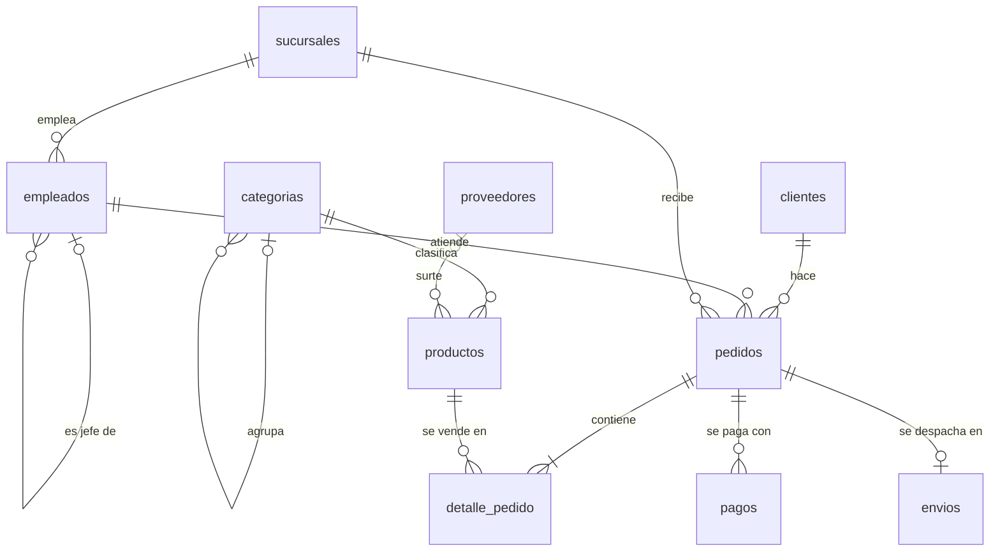

# Caso tienda · Tienda de tecnología con varias sucursales

Un caso para practicar **todo el ciclo de trabajo con SQL** sobre una misma base de datos: construirla y transformarla (DDL), llenarla y modificarla (DML), consultarla a fondo (JOIN, GROUP BY, subconsultas, vistas), protegerla con transacciones (TCL) y controlar quién puede hacer qué (DCL).

Cada laboratorio se trabaja **ejecutando** instrucciones en el SGBD y **observando** lo que ocurre.

---

## 1. La base de datos

Una tienda de tecnología con sede en Aguachica y sucursales en otras ciudades. Vende computadores, celulares, audio y periféricos a personas y empresas; cada pedido lo atiende un vendedor en una sucursal, puede pagarse en una o varias cuotas y puede enviarse por transportadora.



| Tabla | Filas | Qué guarda | Para tener en cuenta |
|---|---:|---|---|
| `sucursales` | 4 | Puntos de venta | Una es nueva: no tiene empleados ni pedidos |
| `empleados` | 12 | Personal de la tienda | `id_jefe` apunta a la misma tabla; la gerente no tiene jefe |
| `categorias` | 15 | Categorías y subcategorías | `id_categoria_padre` apunta a la misma tabla; los productos van siempre en una subcategoría |
| `proveedores` | 8 | Quién surte los productos | Uno no surte ninguno |
| `productos` | 40 | Catálogo, precio, costo y existencias | Uno sin proveedor, uno inactivo, tres nunca vendidos, varios bajo el mínimo |
| `clientes` | 30 | Personas y empresas | Tres nunca compraron; hay correos y teléfonos en NULL |
| `pedidos` | 160 | Encabezado de cada venta | Estados: Pendiente, Pagado, Enviado, Entregado, Cancelado |
| `detalle_pedido` | 416 | Productos de cada pedido | Clave primaria compuesta; guarda el precio del momento de la venta |
| `pagos` | 164 | Pagos y abonos | Un pedido puede tener dos pagos, uno parcial o ninguno |
| `envios` | 103 | Despachos por transportadora | Como máximo uno por pedido; `fecha_entrega` en NULL = en camino |

Los pedidos van de enero de 2025 a septiembre de 2026. Los casos límite están puestos a propósito: son los que hacen fallar una consulta mal planteada.

**Valor de una línea de pedido** (se usa en todo el caso):

```sql
cantidad * precio_unitario * (1 - descuento)
```

---

## 2. Requisitos

- Un servidor **MySQL 8.0** o superior en marcha y un cliente SQL conectado. El [README principal](../README.md) explica cómo levantar el servidor con Docker y cómo conectarse.
- Un usuario con permisos de administración (`root`). El laboratorio 08 y el reto crean cuentas.

---

## 3. Estructura de la carpeta

```
tienda/
├── README.md                    ← este archivo
├── 00_preparacion/
│   ├── 01_esquema.sql           crea (o reinicia) la base tienda
│   └── 02_datos.sql             carga los datos de prueba
├── 01_ddl/                      guia.sql · ejercicios.sql
├── 02_dml/                      guia.sql · ejercicios.sql
├── 03_consultas/                guia.sql · ejercicios.sql
├── 04_joins/                    guia.sql · ejercicios.sql
├── 05_agrupacion/               guia.sql · ejercicios.sql
├── 06_subconsultas_vistas/      guia.sql · ejercicios.sql
├── 07_tcl/                      guia.sql · sesion_A.sql · sesion_B.sql · ejercicios.sql
├── 08_dcl/                      guia_admin.sql · prueba_vendedor.sql · prueba_contador.sql
│                                prueba_bodega.sql · ejercicios.sql
└── 09_reto_integrador/          reto.sql
```

| Archivo | Para qué sirve |
|---|---|
| `00_preparacion/*.sql` | Dejar la base en un estado conocido. Se ejecutan completos, las veces que haga falta. |
| `guia.sql` | Práctica guiada paso a paso: ejecutar, observar y responder preguntas en el cuaderno. |
| `ejercicios.sql` | Enunciados para resolver de forma autónoma, con el resultado esperado para autoevaluarse. |
| `sesion_A/B.sql`, `prueba_*.sql` | Material de apoyo de los laboratorios que usan más de una conexión. |
| `reto.sql` | Un encargo completo, sin guía, que combina los cuatro sublenguajes. |

---

## 4. Orden de trabajo

| Lab | Tema | Lo que se practica |
|---|---|---|
| 01 | **DDL** | `CREATE DATABASE` / `TABLE`, `ALTER TABLE` (`ADD`, `MODIFY`, `CHANGE`, `RENAME`, `DROP`), restricciones sobre tablas con datos, clave foránea compuesta y autorreferencia, índices y `EXPLAIN`, `RENAME`, `TRUNCATE`, `DROP`, `information_schema` |
| 02 | **DML** | `INSERT` (varias filas, `INSERT … SELECT`, `IGNORE`, `ON DUPLICATE KEY`, `REPLACE`), `UPDATE` (expresiones, `CASE`, `JOIN`, subconsulta, `LIMIT`), `DELETE` (integridad referencial, `CASCADE`, `JOIN`), `DELETE` vs `TRUNCATE` vs `DROP` |
| 03 | **Consultas** | `SELECT`, alias, `DISTINCT`, `WHERE`, `BETWEEN`, `IN`, `LIKE`, `NULL`, `ORDER BY`, `LIMIT`/`OFFSET`, funciones de texto, número y fecha, `CASE` |
| 04 | **JOIN** | `INNER`, `LEFT`, `RIGHT`, varias tablas, buscar lo que falta, filtro en `ON` o en `WHERE`, autocombinación, `CROSS JOIN`, `UNION` |
| 05 | **Agrupación** | `COUNT`/`SUM`/`AVG`/`MIN`/`MAX`, `GROUP BY`, `HAVING`, agrupar por fechas, agregación condicional, `WITH ROLLUP`, la trampa de las filas duplicadas |
| 06 | **Subconsultas y vistas** | Subconsultas escalares, `IN`/`ANY`/`ALL`, `EXISTS`, correlacionadas, tablas derivadas, CTE (`WITH`) y recursivas, funciones de ventana, `CREATE VIEW` |
| 07 | **TCL** | `START TRANSACTION`, `COMMIT`, `ROLLBACK`, `SAVEPOINT`, autocommit, COMMIT implícito del DDL, bloqueos, `FOR UPDATE`, lectura repetible, interbloqueo |
| 08 | **DCL** | `CREATE USER`, `GRANT` por base, tabla y columna, `REVOKE`, vistas como filtro, roles, `WITH GRANT OPTION`, bloqueo de cuentas, auditoría de permisos |
| 09 | **Reto integrador** | Un programa de puntos construido de principio a fin |

**Regla de oro:** antes de cada laboratorio (y antes de sus ejercicios) se ejecutan `01_esquema.sql` y luego `02_datos.sql`. Así todos parten de los mismos datos y los resultados coinciden con los que describen las guías. La única excepción es la guía del laboratorio 01, que construye la base desde cero.

---

## 5. Cómo trabajar las guías

1. Abrir el archivo `.sql` en el cliente SQL.
2. Ejecutar **un bloque a la vez**, nunca la guía completa. Los atajos de cada cliente están en el [README principal](../README.md#4-ejecutar-un-script).
3. Antes de ejecutar, **predecir** el resultado: cuántas filas, si pasa o falla.
4. Mirar el panel de resultados y el de mensajes (filas afectadas y errores).
5. Responder en el cuaderno las líneas marcadas `PREGUNTA`.

En los ejercicios de los laboratorios 03 a 06 cada enunciado trae el **resultado esperado** (número de filas). Si no coincide, la consulta no está bien.

---

## 6. Errores a propósito

Las guías incluyen instrucciones que **deben fallar**, marcadas con `ERROR xxxx esperado`. El error es parte de la práctica: se lee el mensaje y se explica la causa.

| Código | Significado | Lab |
|---|---|---|
| 1007 / 1051 | La base ya existe / la tabla no existe | 01 |
| 1044 / 1045 | Sin acceso a la base / usuario o clave incorrectos | 08 |
| 1052 | Columna ambigua: está en más de una tabla del JOIN | 04 |
| 1054 | Columna desconocida (por ejemplo, un alias usado en WHERE) | 03 |
| 1055 / 1140 | Columna en el SELECT que no está en el GROUP BY | 05 |
| 1062 | Valor duplicado en PRIMARY KEY o UNIQUE | 01, 02 |
| 1064 | Error de sintaxis | 02, 04 |
| 1111 | Función de agregación donde no se permite (WHERE) | 05 |
| 1136 | La cantidad de valores no coincide con la de columnas | 02 |
| 1138 | No se puede volver NOT NULL una columna que tiene NULL | 01 |
| 1142 / 1143 | Permiso denegado sobre la tabla / sobre la columna | 08 |
| 1146 | La tabla no existe | 02, 07 |
| 1147 | Se intenta retirar un permiso que no se había dado | 08 |
| 1175 | Modo seguro (UPDATE o DELETE sin clave en el WHERE) | 02 |
| 1205 / 1213 | Tiempo de espera de un bloqueo agotado / interbloqueo | 07 |
| 1222 | Las consultas de un UNION tienen distinto número de columnas | 04 |
| 1227 | La operación exige permisos de administrador | 08 |
| 1242 | Una subconsulta escalar devolvió más de una fila | 06 |
| 1248 | Tabla derivada sin alias | 06 |
| 1265 / 1406 | Valor no permitido o recortado / texto demasiado largo | 01, 02 |
| 1288 | La vista no es actualizable | 06 |
| 1305 | El SAVEPOINT no existe | 07 |
| 1364 | Falta un valor obligatorio (NOT NULL sin DEFAULT) | 02 |
| 1366 | Valor incompatible con el tipo de la columna | 01 |
| 1396 | La cuenta ya existe | 08 |
| 1451 / 1452 | Clave foránea: borrar un padre con hijos / hijo sin padre | 01, 02 |
| 1701 / 3730 | TRUNCATE o DROP de una tabla referenciada por otra | 01, 02 |
| 1824 / 1828 | La tabla referenciada no existe / la columna sostiene una clave foránea | 01 |
| 3118 | Cuenta bloqueada | 08 |
| 3819 | Violación de una restricción CHECK | 01, 02, 07 |

---

## 7. Laboratorios con más de una conexión

### Laboratorio 07 (dos sesiones)

Se necesitan **dos conexiones independientes** al servidor, las dos como `root`:

- **MySQL Workbench:** en la pestaña de inicio, hacer clic en la conexión; volver al inicio y hacer clic **otra vez** en la misma conexión. Quedan dos pestañas de conexión, que son dos sesiones.
- **DBeaver:** abrir un editor SQL y luego *SQL Editor → New SQL script* para el segundo; en cada editor, clic derecho → *Connection → Open separate connection* para que no compartan sesión. Las dos deben estar en modo *Auto-Commit*.

En la primera se abre `sesion_A.sql` y en la segunda `sesion_B.sql`. Se ejecuta un paso a la vez, alternando, en el orden de las etiquetas `[A1]`, `[B1]`… indicado al inicio de `sesion_A.sql`.

Cuando una instrucción se queda "ejecutando", **es lo esperado**: está esperando un bloqueo de la otra sesión.

### Laboratorio 08 (una cuenta por cargo)

`guia_admin.sql` se ejecuta como `root`. Para probar cada cuenta se crea una conexión nueva con los mismos datos de siempre (host `127.0.0.1`, puerto `3306`) cambiando usuario y contraseña:

| Usuario | Contraseña | Archivo de prueba |
|---|---|---|
| `tienda_vendedor` | `Vende*2026` | `prueba_vendedor.sql` |
| `tienda_contador` | `Conta*2026` | `prueba_contador.sql` |
| `tienda_bodega` | `Bodega*2026` | `prueba_bodega.sql` |

La guía indica en qué momento ejecutar cada **PARTE** de cada archivo de prueba.

---

## 8. Problemas frecuentes

| Síntoma | Solución |
|---|---|
| Error 1049 *Unknown database 'tienda'* | Ejecutar `00_preparacion/01_esquema.sql` y `02_datos.sql`. |
| Los resultados no coinciden con la guía o con el resultado esperado | Recargar `00_preparacion`: algún laboratorio anterior modificó los datos. |
| Error 1175 en un UPDATE o DELETE | Ejecutar `SET SQL_SAFE_UPDATES = 0;` (el laboratorio 02 lo explica). |
| Error 1064 al ejecutar varias instrucciones con Ctrl + Enter en DBeaver | Usar Alt + X para ejecutar un bloque. |
| En el lab 07 una instrucción no termina | Está esperando a la otra sesión. Si se agotó el tiempo (error 1205), hacer ROLLBACK en ambas y repetir la parte. |
| En el lab 07 el ROLLBACK "no deshace nada" | El cliente no está en modo Auto-Commit, o se ejecutó un DDL en medio (COMMIT implícito). |
| Error 1045 al conectar como `tienda_vendedor` | En el lab 08 su clave cambia en el PASO 8. |
| Error 1396 al crear una cuenta | Ya existe de una ejecución anterior: ejecutar el PASO 10 (limpieza) de `guia_admin.sql`. |
| Tildes o ñ mal escritas | Verificar que el archivo se abrió con codificación UTF-8. |

---

## 9. Convenciones

- Tablas en **plural** y en minúsculas; vistas con prefijo `v_`.
- Claves primarias con prefijo `id_`; la clave foránea se llama igual que la clave a la que apunta.
- Restricciones con nombre propio: `uq_…` (UNIQUE), `chk_…` (CHECK), `fk_…` (FOREIGN KEY), `idx_…` (índice).
- Dinero siempre en `DECIMAL`; los descuentos se guardan como fracción (`0.10` = 10 %).
